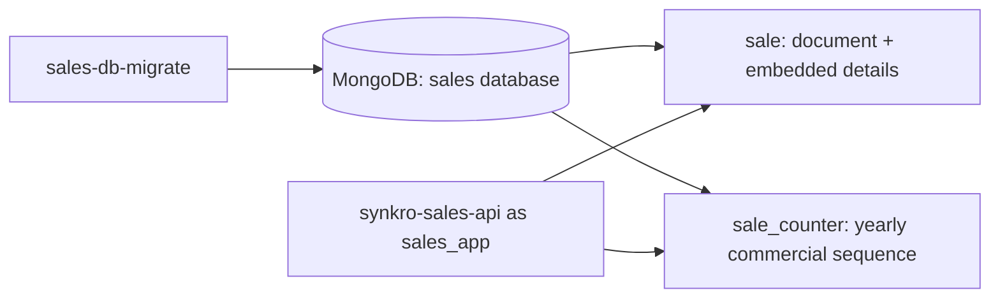

# synkro-sales-db

> MongoDB Sales migrations for the sale document validator, indexes, yearly commercial counter and application permissions.

Part of the **SynkroTech SAS Sales Management System**. Architecture, decisions and
contracts live in [synkro-docs](https://github.com/code-corhuila/synkro-docs).

**Quick start:** with MongoDB's authenticated replica set running, supply protected migration inputs and invoke sales-db-migrate from this root. See [Getting started](#getting-started).

## What it does

- Owns Sales collections, strict validators, indexes and migration history.
- Embeds sale details and preserves authoritative integer-cent amounts.
- Versions the yearly commercial sale counter and replay-compatible rollout.
- Supplies a one-shot Liquibase runner; synkro-infra-mongo owns the instance and volumes.

## Where it fits



MongoDB collections and embedded documents are shown explicitly; arrows do not imply relational foreign keys. The application account is separate from the migration administrator.

## Tech stack

| Component | Choice |
|---|---|
| Engine | MongoDB 7 replica set |
| Migrations | Liquibase with MongoDB extension |
| Runner | Owning Docker image; tooling profile |
| Verification | Validator/index checks and disposable replica-set fixtures |

## Dependencies

| Depends on | Purpose | Configuration |
|---|---|---|
| synkro-infra-mongo | Authenticated replica set and users | platform network |
| Protected migration connection | Owning structure changes | MONGODB_URI / DATABASE / OPTIONS |
| synkro-sales-api | Uses the published document contract | sales_app permissions |

## Getting started

Use **PowerShell or Bash** from this root with an authenticated replica set and local protected configuration prepared from `.env.example`:

```text
docker compose -f deploy/compose.yml --env-file .env run --rm sales-db-migrate update
docker compose -f deploy/compose.yml --env-file .env run --rm sales-db-migrate validate
```

Use the root platform to provision the real MongoDB instance. Credentials are delivered by the runner's protected mechanism; never put a credential-bearing URI into an ad hoc mongosh command.

For the complete platform, start from [synkro-infra-postgres](https://github.com/code-corhuila/synkro-infra-postgres).

## Configuration

The committed [.env.example](.env.example) is the configuration inventory.
Its values are examples; required inputs and defaults follow its comments and the
owning implementation. Keep real secrets in protected local files.

| Variable | Purpose |
|---|---|
| `MONGODB_URI` | Connection address, origin or build-time entry point |
| `MONGODB_DATABASE` | Mongodb database |
| `MONGODB_OPTIONS` | Mongodb options |

## Interface

| Structure / operation | Purpose |
|---|---|
| sale | Strict sale document, embedded details, ownership and replay identity |
| sale_counter | Yearly commercial sequence allocation |
| Liquibase history / lock collections | Owning migration ledger |
| update / validate / status / history | Deliberate migration lifecycle |

Commercial references supplement UUID identity and may have gaps. They do not establish fiscal invoice validity. Rollout preserves already stored sales and replay results.

## Project structure

```text
01_ddl/         collections, validators and indexes
02_dml/         approved document changes
03_dcl/         application role/grant changes
changelog/      owning changeset entry point
deploy/         Liquibase image and credential-safe runner
tests/          contract and real-engine checks
docs/           credentials, verification and rollout detail
```

## Testing

Use the exact disposable replica-set and migration checks preserved in the testing guide below. They validate accepted/rejected documents, indexes, history, application permissions and the commercial counter. They are separate from a platform-wide sale-registration acceptance run.

## Branching and contributing

Use a `feat/`, `fix/` or `chore/` child branch and a PR into `develop`.
Permanent branches are `develop`, `qa` and `main`; none accepts direct commits.
Promote through a `qa-<description>` or release child with `git cherry-pick -x`.
`main` requires approval from `ariel5253`. Use English Conventional Commits.
See [Git conventions](https://github.com/code-corhuila/synkro-docs/blob/main/00-governance/git-conventions.md).

## Further documentation

- [Migration and verification](docs/migration-and-verification.md).
- [Commercial number](docs/commercial-number.md).
- [Domain rules](https://github.com/code-corhuila/synkro-docs/blob/main/02-domain/entities-and-rules.md), [contracts](https://github.com/code-corhuila/synkro-docs/tree/main/07-api/contracts/openapi) and [testing strategy](https://github.com/code-corhuila/synkro-docs/blob/main/11-quality/testing-strategy.md).

<!-- Preserve previously published README section links. -->
<a id="branching"></a>
<a id="migrations-liquibase-over-mongodb"></a>
<a id="run-the-migrations-locally"></a>
<a id="credential-delivery-hu-ven-16-synkro-docs237"></a>
<a id="throwaway-replica-set-no-infrastructure-repo-at-hand"></a>
<a id="checks"></a>
<a id="sample-sale-documents-manual-checks"></a>
<a id="commercial-sale-number-hu-ven-20"></a>
